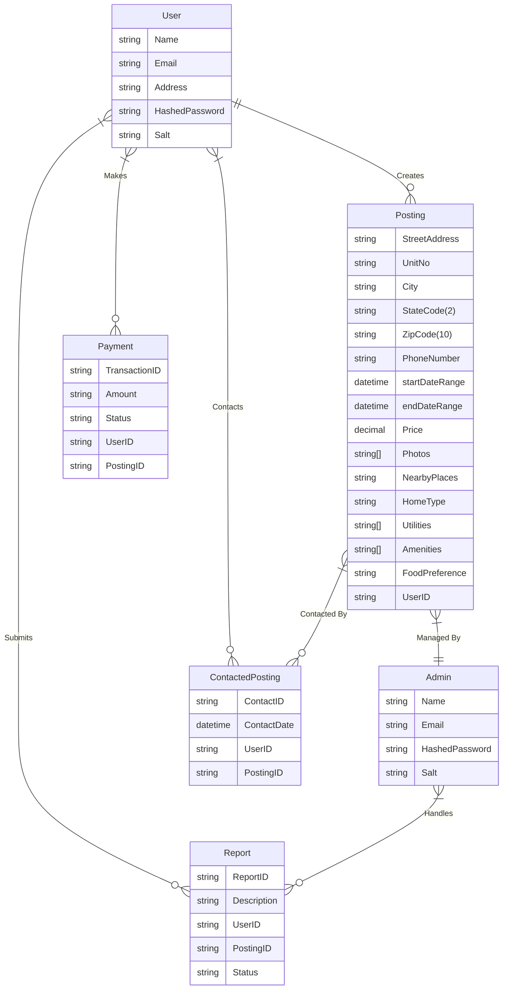
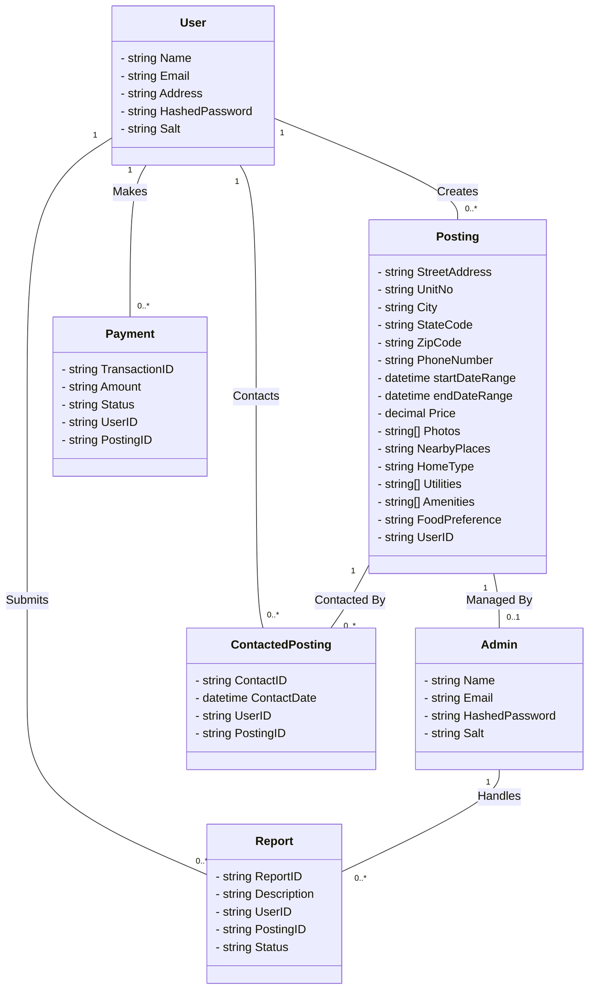

**Roomy**

## Quick start

Use Node.js 22 and npm. Each application has its own package-lock.json; do not install dependencies at the repository root.

1. Clone `https://github.com/KeerthiNethiguntla-28/Roomy.git` and enter the repository.
2. Run `nvm use` (or install Node.js 22), then install each app:

```sh
npm ci --prefix service
npm ci --prefix roomy-client
npm ci --prefix admin-portal
```

3. Copy `service/.env.example` to `service/.env` and each frontend's `.env.example` to `.env.local` in that same directory.
4. Start MongoDB locally or set `MONGO_CONNECTION_STRING` to your own database. Set a unique, long random `JWT_SECRET`. Keep `CORS_ORIGINS` aligned with your frontend origins.
5. Set `NEXT_PUBLIC_MAPBOX_TOKEN` in both frontends and `NEXT_PUBLIC_TOMTOM_KEY` in the user frontend for maps and address search. These browser-visible keys must be restricted to your app origins in the provider dashboards. Maps show an unavailable state without a token.
6. Configure Azure Blob Storage (`BLOB_SERVICE_URL`, including credentials/SAS where needed, and `AZURE_STORAGE_CONTAINER_NAME`) before creating listings with photos. Configure Azure email if notifications are needed; the sender in `azureUtils.js` must belong to your verified email service. Never commit credentials.
7. For test subscriptions, set your own `STRIPE_SECRET_KEY` and `WEBHOOK_SIGNING_SECRET`, and forward Stripe test webhooks to `http://localhost:3000/payments/stripe-webhook`. Payments are unavailable without this configuration. Existing checkout redirect URLs still assume local development; hosted payment flows require a separate repair.
8. Set `ADMIN_EMAIL` and a unique `ADMIN_PASSWORD` of at least 12 characters, then provision an admin:

```sh
cd service
npm run seed:admin
```

The seed command refuses to overwrite an existing admin. Public admin registration is disabled. User accounts can be registered through the user app.

Run these commands in separate terminals from the repository root:

```sh
npm run dev --prefix service
npm run dev --prefix admin-portal -- --port 8080
npm run dev --prefix roomy-client
```

Open the user app at http://localhost:4000 and the admin portal at http://localhost:8080. The API listens on port 3000 by default. Both frontends use `NEXT_PUBLIC_API_URL`; restart/rebuild after changing it. The API waits for MongoDB before listening and rejects missing required configuration.

For production-style startup, build each frontend, then run `npm run start --prefix roomy-client -- --port 4000` and `npm run start --prefix admin-portal -- --port 8080`. Start the API with `npm start --prefix service`.

### Validation

```sh
npm test --prefix service
npm run typecheck --prefix roomy-client
npm run typecheck --prefix admin-portal
npm run build --prefix roomy-client
npm run build --prefix admin-portal
```

Security tests cover listing ownership constraints, safe user context, disabled public admin registration, and safe error responses. They do not replace a full browser/MongoDB integration test. External Azure/Stripe services need your own test credentials. This repository is still undergoing portfolio cleanup; unfinished edit/reset-password controls and payment presentation are not claimed as complete.

## File Structure
- `service/` contains the backend server
  - `Node.js/Express.js/MongoDB`
- `admin-portal/` contains the admin portal
  - `Next.js/React.js`
- `roomy-client/` contains the user client
  - `Next.js/React.js`


Project Overview -

The Room Booking System is a web-based platform designed to facilitate the easy listing and booking of accommodations. Users can create listings for their available spaces, browse and contact postings, and process transactions securely. This application aims to streamline the process of finding short-term rentals for users by providing a user-friendly interface and a robust backend.


# Object Model

## Model for the application

### ER Diagram



### Class Diagram


